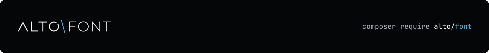

<h1 align="center">
  <a href="https://altophp.com/font">
    
  </a>
</h1>

Inspect, convert, and subset font files from PHP. Read a font's family and
style, find a matching face, or keep only the characters your application uses.

<p align="center">
  
  
  <a href="https://packagist.org/packages/alto/font"></a>
  
  <a href="https://github.com/sponsors/smnandre"></a>
</p>

## Read a font

Save this as `inspect.php`, place your font at `fonts/Inter-Regular.ttf`,
and run `php inspect.php`:

```php
<?php

require __DIR__.'/vendor/autoload.php';

use Alto\Font\Font;

$font = Font::fromFile(__DIR__.'/fonts/Inter-Regular.ttf');

printf("%s %s\n", $font->metadata()->family, $font->metadata()->subfamily);
```

For Inter Regular, this prints `Inter Regular`. See
[Getting started](docs/getting-started.md) to check which characters it contains.

## Installation

```sh
composer require alto/font
```

Requires PHP 8.4+ with Iconv and Zlib. WOFF2 adds Brotli: the PHP extension
or the executable to read, and a compressor passed to the writer; see
[Compression](docs/compress.md).

## Create a smaller font for your text

Create an `output` directory first. Run this as a separate script beside your
`vendor` directory. The destination must not already exist.

```php
<?php

require __DIR__.'/vendor/autoload.php';

use Alto\Font\Font;
use Alto\Font\Subset\SubsetOptions;
use Alto\Font\Subset\UnicodeSet;
use Alto\Font\Writer\WoffWriter;

$font = Font::fromFile(__DIR__.'/fonts/Inter-Regular.ttf');
$result = $font->subset(new SubsetOptions(
    UnicodeSet::fromText('ALTO Font 0123456789'),
));

$destination = __DIR__.'/output/inter-subset.woff';
new WoffWriter()->write($result->font, $destination);

printf("Saved inter-subset.woff (%d bytes)\n", filesize($destination));
```

This creates a WOFF file with the requested characters and the glyphs they
depend on; the original file is unchanged. Use the complete text your
application displays. Read [Subsetting](docs/subset.md) for the character
set, the policies, and the measured sizes.


The illustrated subset uses the text above and default options. The exact size
depends on the source font and the selected characters.

## Choose a task

| I want to... | Guide |
| --- | --- |
| Understand families, faces, files, and glyphs | [Fonts](docs/fonts.md) |
| Read a font's family, style, or license fields | [Metadata](docs/fonts/metadata.md) |
| Check whether a font contains my characters | [Getting started](docs/getting-started.md) |
| Load a file or bytes and read the face | [Reading files](docs/files/read.md) |
| Convert glyph names to Unicode text | [Glyph names](docs/glyphs/names.md) |
| Write a font as TTF, WOFF, or WOFF2 | [Writing files](docs/files/write.md) |
| Serve a font to browsers as WOFF2 | [Compression](docs/compress.md) |
| Reduce a font to the text I use | [Subsetting](docs/subset.md) |
| Find a font by family, weight, and style | [Finding fonts](docs/files/find.md) |
| Inspect variable-font axes and glyph measurements | [Variable fonts](docs/tables/variations.md) |
| Check supported containers and outline formats | [Formats](docs/formats.md) |

The [documentation index](docs/index.md) lists every main guide.

## Supported fonts

ALTO Font works on TrueType outlines in TTF, OpenType, WOFF, and WOFF2 files,
and on individual faces of TTC and OTC collections. Variable fonts keep their
axes through conversion and subsetting. Text shaping and rendering stay with
the application or browser that uses the output; [Formats](docs/formats.md)
details each container.

## Contributing

Contributions of all kinds are welcome. Visit the
[project on GitHub](https://github.com/altophp/font) to
[report a bug](https://github.com/altophp/font/issues/new),
[suggest a feature](https://github.com/altophp/font/issues/new), or
[open a pull request](https://github.com/altophp/font/pulls).

Before submitting code, run:

```bash
# Runs PHP CS Fixer, PHPStan, and PHPUnit
composer qa
```

Changes to public behavior should include tests and documentation.

## Support

ALTO Font is open source and independently maintained by
[Simon André](https://smnandre.dev). If it is useful to your work, you can
support its continued development through
[GitHub Sponsors](https://github.com/sponsors/smnandre).

Sharing the package or
[starring it on GitHub](https://github.com/altophp/font) also helps.

## License

ALTO Font is released by [ALTO PHP](https://altophp.com) under the
[MIT License](LICENSE).
