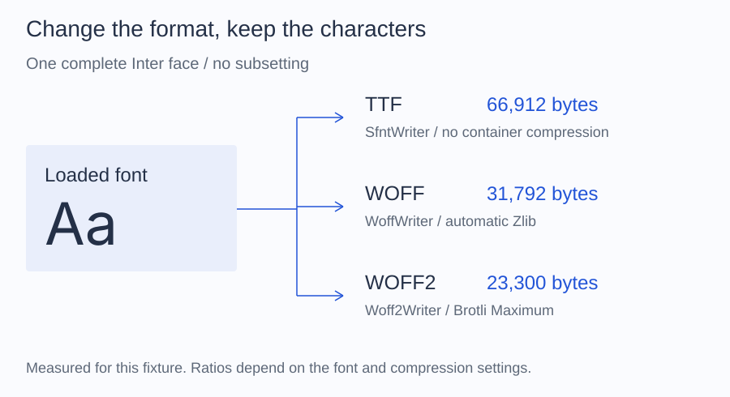

# Sizes

Measure before you decide. The same font gives different sizes depending on
the container, the characters you keep, and the policies, and the ratios
change from one font to the next. Every number on this page was measured on
the bundled Inter Latin sample, a 518-glyph face; they show what each step
changes, not what your font will save.

## The container

Writing the complete face in each container:

| Output | Writer | Size |
| --- | --- | --- |
| TTF | `SfntWriter` | 66,912 bytes |
| WOFF | `WoffWriter` | 31,792 bytes |
| WOFF2, maximum quality | `Woff2Writer` | 23,300 bytes |

The WOFF2 count moves by a few dozen bytes with the Brotli build that
produces it: 23,272 bytes with the `brotli` 1.2 executable.

## Subsetting

For the 98 characters of the translated interface in [Subsetting](../subset.md),
with the `brotli` executable at maximum quality:

| Output | Glyphs kept | WOFF | WOFF2 |
| --- | --- | --- | --- |
| Complete face | 518 | 31,792 bytes | 23,272 bytes |
| Subset, default policies | 409 | 28,652 bytes | 21,284 bytes |
| Subset, compact numbering | 409 | 27,100 bytes | 18,848 bytes |
| Subset, compact, hinting dropped | 409 | 27,072 bytes | 18,760 bytes |

The sample already contains only Latin glyphs, so this subset keeps 409 of
518 and saves little. The 19 characters of `ALTO Font 0123456789` keep 104
glyphs and give a 19,784-byte WOFF with the defaults and 8,308 bytes with
compact numbering; [Policies](../subset/policies.md) shows that example.

## How to measure

Compare files in the same container: a WOFF subset against the WOFF of the
complete face, not against the TTF. `SubsetResult::$sfntSize` is the
uncompressed size and helps to compare policies before writing; the number to
report is `filesize()` of the written output.
