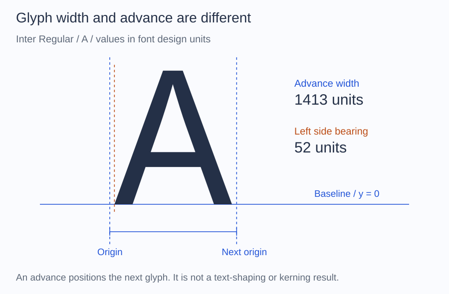
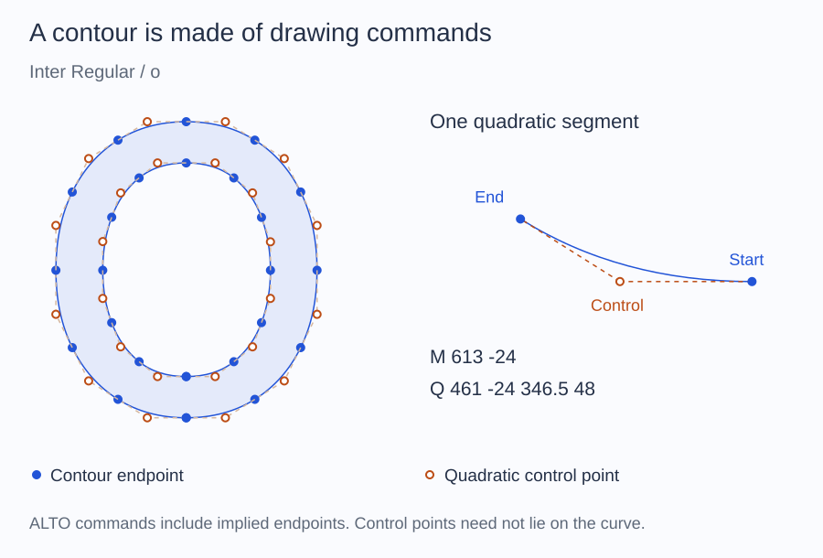

# Glyphs

Font files map Unicode code points to glyph identifiers. Glyph identifiers are
font-specific and must not be reused with another font.

If you already have a glyph name such as `eacute` or `f_f_i`, use
[`GlyphName::toUnicode()`](glyphs/names.md) to derive its Unicode text without
loading a font.

## Resolve a character

Place a font at `fonts/Inter-Regular.ttf` and run this script beside `vendor`.
The remaining examples continue with the same `$font`:

```php
<?php

require __DIR__.'/vendor/autoload.php';

use Alto\Font\Font;

$font = Font::fromFile(__DIR__.'/fonts/Inter-Regular.ttf');
$glyphId = $font->glyphIdForCodepoint(0x00E9); // é

echo null === $glyphId ? "é is missing\n" : "é is available\n";
```

`glyphIdForCodepoint()` returns `null` when the font's character map has no
entry. It does not perform font fallback.

When working with one character, `glyphMetrics()` resolves it and reports a
clear failure if it is absent:

```php
$metrics = $font->glyphMetrics('A');

printf("Glyph: %d\n", $metrics->glyphId->value);
printf("Advance: %d\n", $metrics->advanceWidth);
printf("Side bearing: %d\n", $metrics->leftSideBearing);
```

Passing invalid UTF-8, an empty string, or more than one Unicode code point
raises `InvalidTextException`. A valid character absent from the font raises
`GlyphNotFoundException`. Use the explicit code-point method when absence is
expected.

## Read metrics by identifier

```php
$glyphId = $metrics->glyphId;
$metrics = $font->glyphMetrics($glyphId);
```

The advance width and side bearing use the font's design units, not pixels.



In this Inter fixture, `A` advances by 1,413 units and has a 52-unit left side
bearing. Advance width is the distance to the next origin before shaping;
it is not the width of the visible ink. The measurements use the bundled Inter fixture.

## Read an outline

```php
$outline = $font->glyphOutline($glyphId);

if ($outline->isEmpty()) {
    // Spaces and other non-drawing glyphs can have no contours.
}

foreach ($outline->contours as $contour) {
    foreach ($contour->commands as $command) {
        // M, L, Q, or Z with their design-unit coordinates.
    }
}
```

`M`, `L`, `Q`, and `Z` represent move, line, quadratic curve, and close-path
commands. ALTO Font exposes this neutral geometry without serializing it to
SVG, a bitmap, or another drawing format.



Filled points are contour endpoints; hollow points are quadratic controls.
The enlarged segment is taken directly from `glyphOutline()`. A control point
need not lie on the curve. ALTO's commands include implied endpoints, so these
markers are not an inventory of the original stored font points.

`glyphOutline()` returns geometry rather than an SVG file.

## Transform geometry

Outlines, contours, and path commands accept a two-dimensional affine
transform:

```php
$scale = 16 / $font->face()->unitsPerEm;

$scaled = $outline->transform(
    xx: $scale,
    yx: 0,
    xy: 0,
    yy: -$scale,
    dx: 0,
    dy: 16,
);
```

The example scales the outline to 16 units, flips the font's upward Y axis,
and moves the baseline. It still does not draw the result.

## Contracts

| Signature | Contract |
| --- | --- |
| `glyphIdForCodepoint(int $codepoint): ?GlyphId` | Find the face-specific identifier for one Unicode codepoint. Return `null` when the character map has no entry. |
| `glyphMetrics(GlyphId\|string $glyph): GlyphMetrics` | Read horizontal metrics from an identifier or one Unicode character. |
| `glyphOutline(GlyphId $glyphId): GlyphOutline` | Read neutral contour geometry using an identifier from this face. An empty outline is valid, for example for a space. |

`GlyphMetrics` exposes `glyphId: GlyphId`, `advanceWidth: int`, and
`leftSideBearing: int`. Measurements use font design units. They describe an
individual glyph before text shaping, kerning, or rasterization.

`GlyphId::$value` is a non-negative integer. A glyph identifier is specific to
its font; do not reuse it with another face or after compact subsetting.

`glyphMetrics()` throws `InvalidTextException` for invalid UTF-8, empty text, or more
than one codepoint. A missing character throws `GlyphNotFoundException`.
Identifier-based reads can throw `InvalidFontException` for an out-of-range
identifier or malformed glyph data. Unsupported outline structures throw
`UnsupportedFontException`.

`GlyphOutline` exposes `glyphId` and a list of `contours`. Each contour exposes
its `commands` (`M`, `L`, `Q`, or `Z`). `isEmpty(): bool` reports whether there
are no contours. `transform(float $xx, float $yx, float $xy, float $yy,
float $dx, float $dy): GlyphOutline` returns a new affine-transformed outline.
It does not write SVG or draw pixels. See [Outlines](#read-an-outline).
