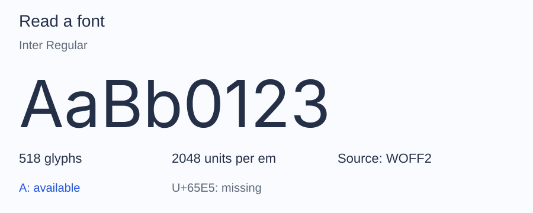

# Glyph counts

A font stores its glyphs in numbered slots, from 0 to one less than the count
declared in its `maxp` table. `face()->glyphCount` reports that count. Slot 0
holds `.notdef`, the shape displayed for a character the font does not map,
and every subset keeps it.

The count is not the number of characters the font covers. A compound glyph
references other glyphs as components, a ligature or an alternate form is
reached through a substitution rule rather than through the character map, and
one glyph can serve several characters. To check one character, use
`glyphIdForCodepoint()`; see [Glyphs](../glyphs.md).

## Counts reported after subsetting

`SubsetResult` reports three counts:

- `mappedCodepointCount` is the number of requested codepoints found in the character map.
- `retainedGlyphCount` is the number of glyphs kept: the mapped glyphs, slot 0, compound components, and the glyphs reachable through preserved substitutions.
- `originalGlyphCount` is the number of slots in the source.

The slot count of the new font depends on the numbering policy. `Preserve`
keeps every slot and empties the unused ones, so `face()->glyphCount` stays
equal to the source. `Compact` renumbers the retained glyphs, so the two
counts match. See [Policies](../subset/policies.md).

## Measured on the Inter sample

The bundled Inter Latin sample has 518 slots:

The text `ALTO Font 0123456789` contains 19 distinct characters, all mapped:

| Policies | Retained glyphs | Slots in the output | WOFF size |
| --- | --- | --- | --- |
| Defaults | 104 | 518 | 19,784 bytes |
| Compact numbering | 104 | 104 | 8,308 bytes |
| Layout dropped | 20 | 518 | 5,608 bytes |
| Compact numbering, layout dropped | 20 | 20 | 2,752 bytes |

With layout preserved, the substitution rules of the font pull in 84 glyphs
beyond the 19 characters and `.notdef`. Dropping layout keeps exactly those 20.
The hinting policy changes the size, not the counts.
