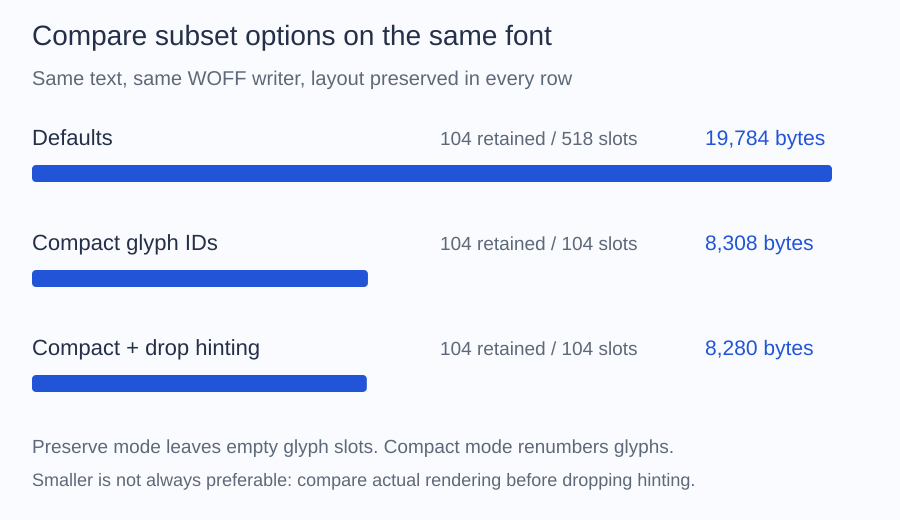

# Policies

Start with the defaults in [Subsetting](../subset.md). Change one
option at a time and compare the output in the application that uses it.

- Glyph numbering defaults to `GlyphIdPolicy::Preserve`. Try `Compact` when you need smaller output and the font supports it.
- Hinting defaults to `HintingPolicy::Keep`. Try `Drop` if smaller output matters more than preserving small-size rendering.
- Text layout defaults to `LayoutPolicy::Preserve`. Remove data only for controlled content that does not need it.



All three examples retain 104 glyphs and preserve layout. Default output is
19,784 bytes with 518 slots; compact output is 8,308 bytes with 104 slots.
Dropping hinting reduces this sample to 8,280 bytes. The small additional saving
does not establish that removing hinting is appropriate for your renderer.
The measurements use the bundled Inter fixture.

## Compact glyph numbers

Run this as a separate script beside `vendor`, with a source font and an
existing `output` directory. The destination must be new.

```php
<?php

require __DIR__.'/vendor/autoload.php';

use Alto\Font\Font;
use Alto\Font\Subset\GlyphIdPolicy;
use Alto\Font\Subset\SubsetOptions;
use Alto\Font\Subset\UnicodeSet;
use Alto\Font\Writer\WoffWriter;

$font = Font::fromFile(__DIR__.'/fonts/Inter-Regular.ttf');
$characters = UnicodeSet::fromText('ALTO Font 0123456789');
$result = $font->subset(new SubsetOptions(
    $characters,
    glyphIds: GlyphIdPolicy::Compact,
));

$destination = __DIR__.'/output/inter-compact.woff';
new WoffWriter()->write($result->font, $destination);

printf("Saved inter-compact.woff (%d bytes)\n", filesize($destination));
```

Compact mode closes gaps in glyph numbering and rewrites the related data.
Compare its file size with a default subset written in the same format.
It can reject fonts containing structures that cannot be safely rewritten;
see the [support reference](../tables.md).

Keep the default if another part of your application stores original glyph
identifiers. Compact mode also removes glyph names, and one renderer is known
to depend on them: CoreText renders Recursive differently without its glyph
names and extra glyphs, as the
[technical diagnosis](https://github.com/altophp/font/blob/main/tests/Validation/RECURSIVE_RENDERING.md)
records. Matching outlines and positioning do not guarantee matching pixels
on every renderer; compare small text as well as large text before shipping.

## Remove hinting

To test this option, replace the `SubsetOptions` call in your script with:

```php
use Alto\Font\Subset\HintingPolicy;

$result = $font->subset(new SubsetOptions(
    $characters,
    hinting: HintingPolicy::Drop,
));
```

Removing hinting can reduce the file but may change sharpness or spacing on
the target renderer. Keep it unless you have checked the sizes and devices
your application uses. [Hinting](../tables/hinting.md) explains what the
instructions do and which tables `Drop` removes.

## Remove text layout data

Keep `LayoutPolicy::Preserve` for ordinary text. Layout data controls
ligatures, joining, kerning, and mark placement; [Layout](../tables/layout.md)
explains the tables involved.

`LayoutPolicy::SubstitutionsOnly` keeps supported substitutions but removes
OpenType positioning. `LayoutPolicy::Drop` removes both. These options can
break prose or scripts that depend on shaping; reserve them for controlled
content such as isolated symbols. Legacy kerning is retained independently,
so `Drop` does not mean every kerning adjustment is removed.

## Subset a variable font

Subset the original variable font. Supported axes remain available in the
output. Exporting a fixed weight or restricting axis ranges is unsupported.

If you obtained a selected view from `withVariations()` or a weighted finder
query, call `withoutVariations()` before subsetting. This returns to the full
variable source; it does not keep only the selected weight.

Always review `SubsetResult::$warnings`. For precise table and offset limits,
see [Tables](../tables.md) and [Variable fonts](../tables/variations.md).

To compare output sizes before shipping, see [Sizes](../compress/sizes.md);
[Glyph counts](../glyphs/counts.md) explains why a subset keeps more glyphs
than characters.
