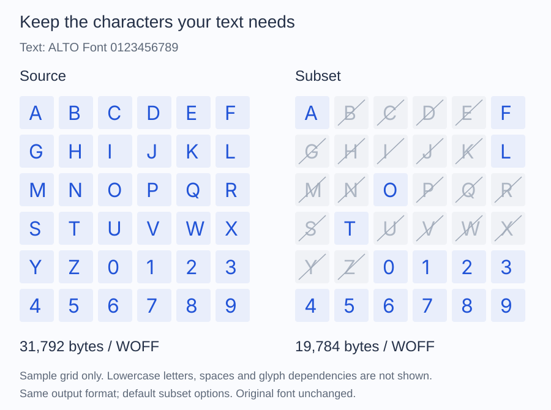

# Results

Read the result of a subset before writing it: which requested characters the
font could not map, how many glyphs stayed, and what the subsetter had to
change. The numbers come from the `SubsetResult` that `Font::subset()` returns.

## List the characters the font cannot map

A requested character absent from the source is dropped without a warning.
When every character is required, check before subsetting:

```php
$missing = [];
foreach ($characters as $codepoint) {
    if (null === $font->glyphIdForCodepoint($codepoint)) {
        $missing[] = sprintf('U+%04X', $codepoint);
    }
}

if ([] !== $missing) {
    throw new RuntimeException('Characters missing from the font: '.implode(', ', $missing));
}
```

After subsetting, `$result->mappedCodepointCount` is the number of requested
codepoints that were found; compare it with `count($characters)`.

## Read the counts

- `mappedCodepointCount` counts the requested codepoints found in the character map.
- `retainedGlyphCount` counts the glyphs kept: the mapped ones, `.notdef`, compound components, and the glyphs reachable through preserved substitutions.
- `originalGlyphCount` counts the glyph slots in the source.
- `sfntSize` is the size of the uncompressed result in bytes, before WOFF or WOFF2 compression.

For `ALTO Font 0123456789` on the bundled Inter Latin sample, 19 characters are
mapped and 104 glyphs stay. The grid shows which of A to Z and 0 to 9 remain
mapped:



With the default `GlyphIdPolicy::Preserve`, the new font keeps all 518 slots
and empties the unused ones, so `$result->font->face()->glyphCount` is still
518; `retainedGlyphCount` is the number to report. [Glyph counts](../glyphs/counts.md)
details each count and the effect of the policies.

## Read the warnings

`$result->warnings` lists what the subsetter transformed or could not keep:

```php
foreach ($result->warnings as $warning) {
    fwrite(STDERR, $warning."\n");
}
```

Read them before distributing the output. They do not list missing characters;
the check above does.

## Measure the output

`sfntSize` is the uncompressed size. The size that matters for a web font is
the written file: call `filesize()` on the WOFF or WOFF2 output, and compare
the complete font and the subset in the same container. [Sizes](../compress/sizes.md)
lists measured sizes for the bundled sample.

## Use the new font

`$result->font` is a regular `Font`: read its metadata and metrics, resolve
glyphs, or pass it to a writer. With compact numbering, glyph identifiers
differ from the source; resolve them from the new font, never from the old one.
