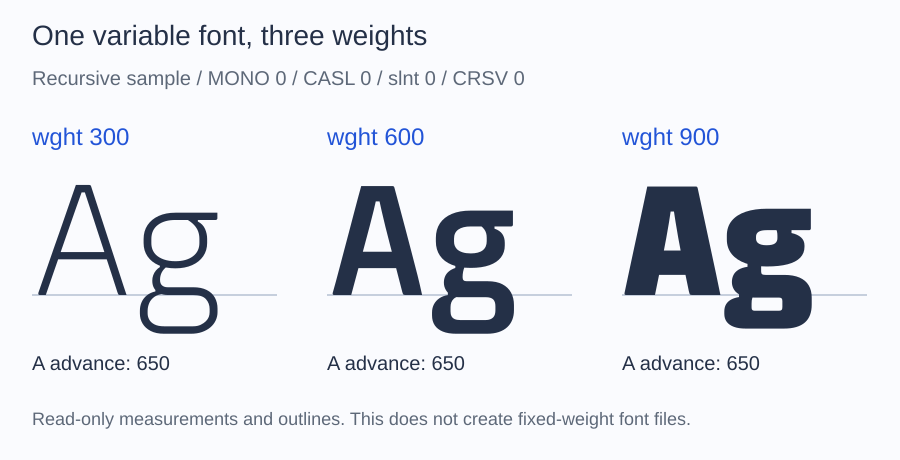

# Variable fonts

Use a variable font when one file should provide several weights or widths:
it stores a default face plus deltas along designer-defined axes, and any
position on those axes is a valid instance. The package lists the axes, reads
measurements and outlines at a chosen position, and keeps the axes intact
when writing or subsetting: a position is read through a view, and files are
written from the source with all its axes.

## List the available axes

Place a variable TrueType font at `fonts/Variable.ttf`, then run this script
beside `vendor`:

```php
<?php

require __DIR__.'/vendor/autoload.php';

use Alto\Font\Font;

$font = Font::fromFile(__DIR__.'/fonts/Variable.ttf');
$variations = $font->variations();

if (null === $variations) {
    echo "This is a static font.\n";
} else {
    foreach ($variations->axes as $axis) {
        printf(
            "%s: %g to %g, default %g\n",
            $axis->tag,
            $axis->minimum,
            $axis->maximum,
            $axis->default,
        );
    }
}
```

For a weight axis, a line might be `wght: 100 to 900, default 400`. The actual
ranges depend on the file. Axes also expose their optional name and hidden
flag; named presets are available through `$variations->instances`.

## What the file contains

A static font stores one face per file. A variable font adds deltas that move
outline points and adjust metrics: `fvar` declares the axes and the named
instances such as Bold or Light, `avar` remaps axis values, `gvar` holds the
outline deltas for `glyf` fonts, `HVAR`, `MVAR`, and `VVAR` hold the metric
deltas, and `STAT` describes the design space. Without them, the remaining
tables form a complete static font: the default instance. The package reads
TrueType-flavored variable fonts: `glyf` with `gvar`, `avar`, and `HVAR`.

## Compare a glyph at another weight

Continue the script with a font that has a `wght` axis and contains `A`:

```php
if (null === $variations || !$variations->hasAxis('wght')) {
    throw new RuntimeException('Choose a variable font with a weight axis.');
}

$bold = $font->withVariations(['wght' => 700]);

printf("Default A advance: %g\n", $font->glyphMetrics('A')->advanceWidth);
printf("Selected A advance: %g\n", $bold->glyphMetrics('A')->advanceWidth);
```

Both values are in font design units. They may be equal if that glyph's advance
does not vary. Use `$bold->glyphOutline($bold->glyphMetrics('A')->glyphId)` to read
its selected outline as well. The original `$font` remains unchanged.

Values outside an axis range are clamped. Unknown axes and selections on
static fonts raise `InvalidFontException`. Query the available axes before
assuming that a font has width (`wdth`) or any other axis.



This uses the bundled Recursive-derived sample, with the other axes fixed as
shown. The outline changes while `A` keeps the same 650-unit advance. Each
column comes from an ALTO read-only view; no static font was exported. Glyphs
are placed by their advances without text shaping or kerning.
The illustration uses the bundled variable-font fixture.

## Return to the source for conversion or subsetting

`$bold->withoutVariations()` returns the original variable source with all its
axes. It does not freeze weight 700. A weighted [finder query](../files/find.md)
can also return a selected view, with the same writing restrictions.

## Select coordinates

- `variations(): ?FontVariations` returns the axes (tag, minimum, default, maximum, flags, optional name) and the named instances, or `null` for a static face.
- `withVariations(array|VariationCoordinates $coordinates): Font` returns a new view at the requested position. Array keys are axis tags; values are integers or floats. Unspecified axes use their defaults, out-of-range values are clamped, and an unknown axis or a static font raises `InvalidFontException`.
- `variationCoordinates(): ?VariationCoordinates` returns the resolved coordinates of a view, or `null` for the source.
- `withoutVariations(): Font` returns the source with all its axes; on the source itself it returns the same object.

A `VariationCoordinates` object can also be built with `defaults($variations)`
and `with()`. A view affects glyph measurements and outlines; it is not a
static font, and writing or subsetting it raises `UnsupportedFontException`.
Text shaping and rendering at those coordinates belong to the application.

## Subset a variable font

A subset keeps every axis of its source: compact mode remaps the per-glyph
`gvar` data and the `HVAR` and `VVAR` mappings together with the glyphs, and
rebuilds the variation stores without unrelated bytes. To subset a view
created with `withVariations()`, return to the source with
`withoutVariations()` first. See [Policies](../subset/policies.md#subset-a-variable-font).
